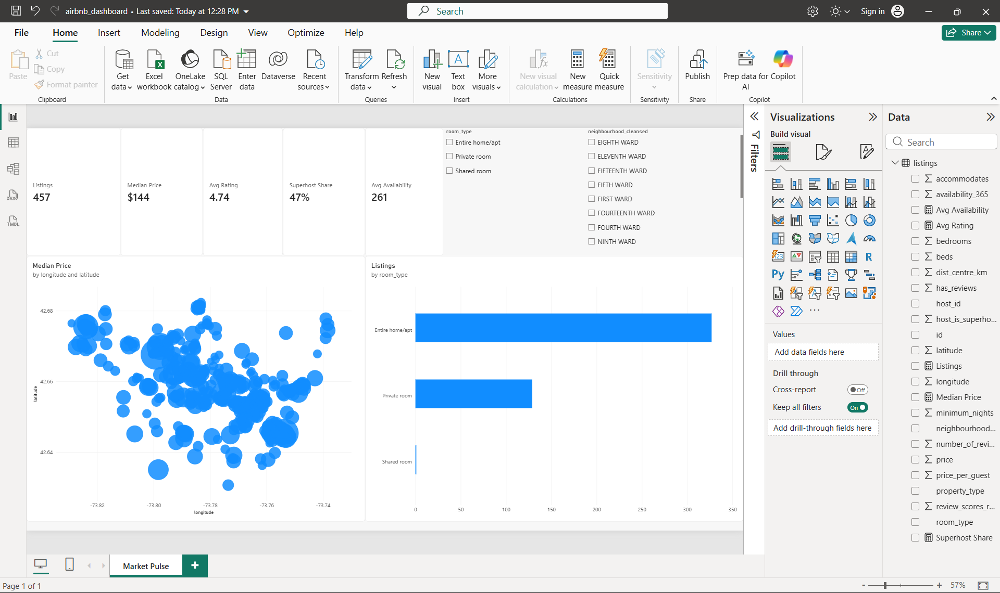

# 🔎 Data Science Tool Mastery Project
### Six Case Files: from messy evidence to a working dashboard

> *"Every dataset is a witness. Some are honest, some are sloppy, and a few are quietly lying. My job this internship was to learn how to interview all of them."*

**Author:** Manindra Shukla · **Type:** Statistical internship project (Internship #4) · **Stack:** Python · SQL · Scikit-learn · Power BI

---

## 📌 Table of Contents
1. [Project Overview](#1-project-overview)
2. [Objectives](#2-objectives)
3. [Tools and Why I Chose Them](#3-tools-and-why-i-chose-them)
4. [Repository Structure](#4-repository-structure)
5. [Getting Started](#5-getting-started)
6. [The Six Case Files](#6-the-six-case-files)
   - [Case File 01: The Messy Evidence (Python and Data Cleaning)](#case-file-01-the-messy-evidence)
   - [Case File 02: The Interrogation (Statistics and EDA)](#case-file-02-the-interrogation)
   - [Case File 03: The Exhibit Wall (Data Visualization)](#case-file-03-the-exhibit-wall)
   - [Case File 04: The Prediction Room (Machine Learning)](#case-file-04-the-prediction-room)
   - [Case File 05: The Records Office (SQL)](#case-file-05-the-records-office)
   - [Case File 06: The Briefing Room (BI Dashboard)](#case-file-06-the-briefing-room)
7. [Visualization Guide](#7-visualization-guide-what-to-build-what-it-should-say)
8. [Results and Insights](#8-results-and-insights)
9. [Reflection: Skills Demonstrated](#9-reflection-skills-demonstrated)
10. [Contact](#11-contact)

---

## 1. Project Overview

This is my fourth internship project, and I wanted it to be different from the first three. Instead of treating each tool as an isolated tutorial, I treated the whole project as a **case-file investigation**: six short cases, each with a question, a dataset (a "witness"), a toolset, and a finding I had to defend.

The twist is that the cases are connected. Three of them follow one dataset, a city's Airbnb listings, from raw mess, through statistical interrogation, into a predictive model and finally a dashboard. The other three each bring in a fresh witness (global CO₂ data and a record-store sales database) so I could practise starting from zero.

**The one-sentence version:** *I took real public data through the full analytics life cycle (clean → explore → visualize → model → query → present) and documented every decision along the way.*

**What a reader can expect to find here:**
- Runnable notebooks with commented code
- Plain-English write-ups of what I found and what I got wrong first
- A model with honest evaluation, including a baseline and its limits
- SQL queries that go beyond `SELECT *`
- A BI dashboard design built for decision-makers, not just for looking pretty

---

## 2. Objectives

| # | Objective | Case File |
|---|-----------|-----------|
| 1 | Build fluency in Python for data work (NumPy, Pandas) and practise real cleaning, transformation, filtering and aggregation | 01 |
| 2 | Apply statistical analysis and exploratory data analysis to find patterns and test claims | 02 |
| 3 | Communicate with Matplotlib and Seaborn visuals that make a point | 03 |
| 4 | Train and evaluate a machine learning model with Scikit-learn (preprocessing, feature prep, training, evaluation) | 04 |
| 5 | Query relational data with SQL (joins, CTEs, window functions) | 05 |
| 6 | Design a BI dashboard (Power BI or equivalent) and package everything as a portfolio-ready project | 06 |

---

## 3. Tools and Why I Chose Them

| Tool | Used for | Why this one |
|------|----------|--------------|
| **Python 3.10+** | Everything analytical | The industry default; one language from cleaning to modelling |
| **NumPy** | Vectorised maths (e.g., geographic distance) | Shows I understand *why* loops are slow, not just that they are |
| **Pandas** | Loading, cleaning, grouping | The workhorse of tabular data |
| **SciPy** | Hypothesis tests | Standard, well-documented statistical tests |
| **Matplotlib + Seaborn** | Static visuals | Matplotlib for control, Seaborn for statistical defaults |
| **Scikit-learn** | Pipelines, models, evaluation | Pipelines keep preprocessing honest and leakage-free |
| **SQLite + SQL** | Relational querying | Zero setup, and the SQL skills transfer to PostgreSQL/MySQL |
| **Power BI Desktop** | Dashboard | Widely used in business roles. *Note: Desktop is Windows-only, so Tableau Public, Looker Studio or Metabase are good equivalents on other systems.* |
| **Jupyter + Git/GitHub** | Notebooks and version control | Reproducibility and a public paper trail |

---

## 4. Repository Structure

```text
data-science-tool-mastery/
│
├── README.md                      ← you are here
├── requirements.txt
├── .gitignore                     ← ignores data/raw and large files
│
├── data/
│   ├── raw/                       ← downloaded files (not committed)
│   └── processed/                 ← cleaned outputs
│
├── notebooks/
│   ├── 01_messy_evidence_cleaning.ipynb
│   ├── 02_interrogation_eda_stats.ipynb
│   ├── 03_exhibit_wall_visualization.ipynb
│   ├── 04_prediction_room_ml.ipynb
│   └── 05_records_office_sql.ipynb
│
├── src/
│   ├── __init__.py
│   └── geo.py                     ← NumPy haversine helper
│
├── sql/
│   └── chinook_queries.sql        ← all SQL, version-controlled
│
├── dashboard/
│   ├── airbnb_dashboard.pbix      ← Power BI file (open in Power BI Desktop)
│   └── screenshots/market_pulse.png
│
├── reports/
│   ├── figures/                   ← exported charts
│   └── findings.md                ← the written case conclusions
│
└── models/
    └── price_model.joblib
```

---

## 5. Getting Started

```bash
# 1. Clone and enter the project
git clone https://github.com/<Manindra07>/data-science-tool-mastery.git
cd data-science-tool-mastery

# 2. Create an environment
python -m venv .venv
source .venv/bin/activate          # Windows: .venv\Scripts\activate

# 3. Install dependencies
pip install -r requirements.txt

# 4. Launch Jupyter
jupyter lab
```

**`requirements.txt`**
```text
numpy>=1.24
pandas>=2.0
scipy>=1.10
matplotlib>=3.7
seaborn>=0.12
scikit-learn>=1.2
joblib>=1.3
jupyterlab>=4.0
```

**Data to download before running** (the raw files are not committed, to respect size limits and licences):

| File | Source | Save as |
|------|--------|---------|
| Airbnb detailed listings for one city (this project uses Albany, New York; any city works) | [insideairbnb.com/get-the-data](http://insideairbnb.com/get-the-data/) → `listings.csv.gz` | `data/raw/listings.csv.gz` |
| Our World in Data CO₂ dataset | Loaded directly by URL in notebook 03 | n/a |
| Chinook sample database (SQLite) | [github.com/lerocha/chinook-database](https://github.com/lerocha/chinook-database) → `Chinook_Sqlite.sqlite` | `data/raw/Chinook_Sqlite.sqlite` |

---

## 6. The Six Case Files

---

### Case File 01: The Messy Evidence
**Objective 1 · Python, NumPy, Pandas · Cleaning, transformation, filtering, aggregation**

**The case:** *A city's short-term rental market is described by thousands of listings, but the raw file is a mess. Prices are text with `$` signs, percentages are strings, booleans are `"t"`/`"f"`, and some listings charge absurd amounts. Can I turn this into evidence I'd trust?*

**Dataset:** [Inside Airbnb](http://insideairbnb.com/get-the-data/) detailed listings for one city.
**Why this dataset:** It is real, public, and *genuinely messy*, which is exactly what I wanted for a cleaning exercise. Toy datasets teach syntax; messy ones teach judgment. It also has geographic coordinates, which let me bring in NumPy for a practical, vectorised calculation.

#### Notebook outline
1. **Meet the witness:** shape, dtypes, memory use, first look at nulls
2. **Fix the types:** price strings → numbers, `t/f` → 1/0, dates → datetime
3. **Handle missing values:** decide *per column* whether to drop, fill, or flag, and write down why
4. **Tame outliers:** cap at percentiles, and document the rule
5. **Engineer features:** distance to the city centre (NumPy), host tenure in years, price per guest
6. **Aggregate:** neighbourhood and room-type summaries
7. **Save the clean file** for later case files

#### Sample code

**`src/geo.py`: a vectorised haversine (no loops)**
```python
import numpy as np

def haversine_km(lat, lon, lat0, lon0):
    """Great-circle distance in km from points (lat, lon) to a single point (lat0, lon0).
    Works on NumPy arrays or Pandas Series, with no Python loop needed."""
    lat, lon, lat0, lon0 = map(np.radians, (lat, lon, lat0, lon0))
    a = (np.sin((lat - lat0) / 2) ** 2
         + np.cos(lat0) * np.cos(lat) * np.sin((lon - lon0) / 2) ** 2)
    return 2 * 6371.0088 * np.arcsin(np.sqrt(a))   # Earth's mean radius in km
```

**Notebook 01: loading and cleaning**
```python
from pathlib import Path
import numpy as np
import pandas as pd
import sys
sys.path.append("..")                       # so we can import from src/
from src.geo import haversine_km

RAW = Path("../data/raw/listings.csv.gz")
OUT = Path("../data/processed/listings_clean.csv")
CITY_CENTRE = (42.6526, -73.7562)           # downtown Albany, NY; change for your city

cols = ["id", "host_id", "host_since", "host_is_superhost", "host_response_rate",
        "neighbourhood_cleansed", "latitude", "longitude", "property_type",
        "room_type", "accommodates", "bedrooms", "beds", "price",
        "minimum_nights", "availability_365", "number_of_reviews",
        "review_scores_rating", "instant_bookable"]

df = pd.read_csv(RAW, usecols=cols)
print(df.shape)
df.info()

# --- 1. Fix types -----------------------------------------------------------
# Prices arrive like "$1,250.00": strip symbols, then convert
df["price"] = pd.to_numeric(
    df["price"].astype("string").str.replace(r"[$,]", "", regex=True),
    errors="coerce")

# "98%" -> 0.98
df["host_response_rate"] = pd.to_numeric(
    df["host_response_rate"].astype("string").str.rstrip("%"),
    errors="coerce") / 100

# "t"/"f" -> 1/0 (NaN stays NaN, so I can decide how to treat unknowns later)
for col in ["host_is_superhost", "instant_bookable"]:
    df[col] = df[col].map({"t": 1, "f": 0})

df["host_since"] = pd.to_datetime(df["host_since"], errors="coerce")

# --- 2. Missing values: decide column by column ----------------------------
missing = df.isna().mean().sort_values(ascending=False)
print(missing[missing > 0].round(3))

df = df.dropna(subset=["price"])                       # no price = no use for pricing analysis
df["has_reviews"] = df["review_scores_rating"].notna().astype(int)   # keep the signal "never reviewed"
df["bedrooms"] = df["bedrooms"].fillna(df.groupby("room_type")["bedrooms"].transform("median"))
df["beds"] = df["beds"].fillna(df["accommodates"] / 2).round()       # simple, documented assumption

# --- 3. Outliers: cap, don't silently delete -------------------------------
low, high = df["price"].quantile([0.01, 0.99])
print(f"Keeping prices between {low:.0f} and {high:.0f}")
df = df[df["price"].between(max(low, 10), high)].copy()

# --- 4. Feature engineering -------------------------------------------------
df["dist_centre_km"] = haversine_km(df["latitude"], df["longitude"], *CITY_CENTRE)
df["host_tenure_years"] = (pd.Timestamp.today() - df["host_since"]).dt.days / 365.25
df["price_per_guest"] = df["price"] / df["accommodates"].clip(lower=1)

# --- 5. Filtering and aggregation ------------------------------------------
entire_homes = df.query("room_type == 'Entire home/apt' and accommodates >= 4")

summary = (df.groupby("neighbourhood_cleansed")
             .agg(listings=("id", "count"),
                  median_price=("price", "median"),
                  avg_rating=("review_scores_rating", "mean"),
                  superhost_share=("host_is_superhost", "mean"))
             .query("listings >= 30")
             .sort_values("median_price", ascending=False))
print(summary.head(10).round(2))

# --- 6. Save ----------------------------------------------------------------
OUT.parent.mkdir(parents=True, exist_ok=True)
df.to_csv(OUT, index=False)
```

> **Case closed when:** I can state, in a short table, *what I removed, what I filled, and why*, with row counts before and after.

---

### Case File 02: The Interrogation
**Objective 2 · Statistical analysis and EDA**

**The case:** *Hosts and guests both say "Superhosts charge more" and "the city centre is expensive." Are these claims supported by the data, or just folklore?*

**Dataset:** The cleaned Airbnb file from Case File 01.
**Why this dataset:** Reusing it forces me to work with *my own* cleaning decisions, and any mistakes in Case 01 show up here, which is great practice for realistic data work.

#### Notebook outline
1. **Distribution check:** is price skewed? (Spoiler: almost always yes, so use medians and logs.)
2. **Univariate and bivariate EDA:** distributions, correlations, group comparisons
3. **Hypothesis tests:** pick the right test and *state the assumptions*
4. **Effect size and uncertainty:** a p-value alone isn't a finding; add a bootstrap confidence interval
5. **Write the verdict:** a plain-English conclusion per claim

#### Sample code
```python
import numpy as np
import pandas as pd
from scipy import stats

df = pd.read_csv("../data/processed/listings_clean.csv")

# --- Distribution shape: is price normal? ----------------------------------
print("Skewness of price:    ", round(stats.skew(df["price"]), 2))
print("Skewness of log price:", round(stats.skew(np.log(df["price"])), 2))
# Strong right skew -> use medians, non-parametric tests, and log-transforms

# --- Claim 1: Superhosts charge more ---------------------------------------
a = df.loc[df["host_is_superhost"] == 1, "price"].to_numpy()
b = df.loc[df["host_is_superhost"] == 0, "price"].to_numpy()

# Mann-Whitney U: no normality assumption, which suits skewed prices
u_stat, p_value = stats.mannwhitneyu(a, b, alternative="two-sided")
print(f"Median superhost: {np.median(a):.0f} | non-superhost: {np.median(b):.0f} | p = {p_value:.4g}")

# Bootstrap a 95% CI for the difference in medians (effect size with uncertainty)
rng = np.random.default_rng(42)
diffs = [np.median(rng.choice(a, len(a))) - np.median(rng.choice(b, len(b)))
         for _ in range(2000)]
ci_low, ci_high = np.percentile(diffs, [2.5, 97.5])
print(f"Median difference 95% CI: [{ci_low:.1f}, {ci_high:.1f}]")

# --- Claim 2: closer to the centre = pricier --------------------------------
rho, p = stats.spearmanr(df["dist_centre_km"], df["price"])
print(f"Spearman rho (distance vs price): {rho:.3f}, p = {p:.4g}")

# --- Claim 3: price differs across room types -------------------------------
groups = [g["price"].to_numpy() for _, g in df.groupby("room_type")]
h_stat, p = stats.kruskal(*groups)
print(f"Kruskal-Wallis across room types: H = {h_stat:.1f}, p = {p:.4g}")

# --- A confounder check: is the 'superhost premium' just bigger homes? ------
print(df.groupby(["room_type", "host_is_superhost"])["price"].median().unstack().round(1))
```

> **The lesson I'm aiming to show:** a significant p-value on a big dataset is almost guaranteed. What matters is *how big* the difference is and whether something else (room type, location) explains it.

---

### Case File 03: The Exhibit Wall
**Objective 3 · Data visualization with Matplotlib and Seaborn**

**The case:** *Global CO₂ emissions: who emits the most, who emits the most per person, and is economic growth still tied to emissions?* One chart per question, each built to make a single point.

**Dataset:** [Our World in Data CO₂ and Greenhouse Gas Emissions dataset](https://github.com/owid/co2-data).
**Why this dataset:** It is well-documented, openly licensed, updated regularly, and loadable directly from a URL, which makes the notebook reproducible with no manual downloads. It also gives me a *different shape* of data (country × year panel) from the Airbnb cross-section, so I practise two kinds of chart thinking.

#### Notebook outline
1. Load, filter out regional aggregates (rows without an ISO code)
2. **Exhibit A:** line chart, per-capita emissions over time for selected countries
3. **Exhibit B:** scatter (log-log) of GDP per person vs CO₂ per person, sized by population
4. **Exhibit C:** heatmap of emissions by country and decade
5. Style pass: consistent palette, direct labels, titles that state the finding
6. Export figures to `reports/figures/`

#### Sample code
```python
import numpy as np
import pandas as pd
import matplotlib.pyplot as plt
import seaborn as sns

URL = "https://raw.githubusercontent.com/owid/co2-data/master/owid-co2-data.csv"
df = pd.read_csv(URL)

# Rows with no ISO code are regions/aggregates (e.g., "World", "Europe"), so exclude them
countries = df[df["iso_code"].notna() & (df["iso_code"] != "OWID_WRL")].copy()
countries["gdp_per_capita"] = countries["gdp"] / countries["population"]

sns.set_theme(style="whitegrid", context="talk")

# --- Exhibit A: per-capita emissions, selected countries -------------------
focus = ["India", "China", "United States", "Germany", "Brazil", "United Kingdom"]
a = countries[countries["country"].isin(focus) & (countries["year"] >= 1960)]

fig, ax = plt.subplots(figsize=(11, 6))
sns.lineplot(data=a, x="year", y="co2_per_capita", hue="country", linewidth=2.4, ax=ax)
ax.set(title="The gap is narrowing, but not evenly: CO₂ per person (tonnes)",
       xlabel="", ylabel="Tonnes per person")
ax.legend(title="", frameon=False, loc="upper left")
sns.despine()
plt.tight_layout()
plt.savefig("../reports/figures/A_co2_per_capita.png", dpi=200)
plt.show()

# --- Exhibit B: richer = more emissions? (one year, log-log) ---------------
YEAR = 2021                                   # pick the latest year with solid coverage
b = countries[(countries["year"] == YEAR)].dropna(
    subset=["gdp_per_capita", "co2_per_capita", "population"])

fig, ax = plt.subplots(figsize=(10, 7))
ax.scatter(b["gdp_per_capita"], b["co2_per_capita"],
           s=b["population"] / b["population"].max() * 3000,   # bubble area ∝ population
           alpha=0.45, edgecolor="white")
ax.set(xscale="log", yscale="log",
       title=f"Wealth and emissions rise together, with big exceptions ({YEAR})",
       xlabel="GDP per person (log scale)", ylabel="CO₂ per person, tonnes (log scale)")

# Label only the biggest populations so the chart stays readable
for _, r in b.nlargest(8, "population").iterrows():
    ax.annotate(r["country"], (r["gdp_per_capita"], r["co2_per_capita"]),
                xytext=(5, 5), textcoords="offset points", fontsize=11)
sns.despine()
plt.tight_layout()
plt.savefig("../reports/figures/B_gdp_vs_co2.png", dpi=200)
plt.show()

# --- Exhibit C: heatmap, top emitters by decade ----------------------------
c = countries[countries["year"] >= 1950].copy()
c["decade"] = (c["year"] // 10) * 10
top = c.groupby("country")["co2"].sum().nlargest(12).index
pivot = (c[c["country"].isin(top)]
         .groupby(["country", "decade"])["co2"].mean()
         .unstack().loc[top])

fig, ax = plt.subplots(figsize=(11, 6))
sns.heatmap(pivot, cmap="rocket_r", linewidths=0.4, cbar_kws={"label": "Mean annual CO₂ (Mt)"}, ax=ax)
ax.set(title="Who emitted, and when: mean annual CO₂ by decade", xlabel="", ylabel="")
plt.tight_layout()
plt.savefig("../reports/figures/C_emissions_heatmap.png", dpi=200)
plt.show()
```

> **Design rules I'm holding myself to:** titles state the finding (not "Line chart of CO₂"), one message per chart, no chart junk, and colour used for meaning rather than decoration.

---

### Case File 04: The Prediction Room
**Objective 4 · Machine learning with Scikit-learn**

**The case:** *Can I predict a listing's nightly price from its basic characteristics, and, just as important, how much should I trust that prediction?*

**Dataset:** Cleaned Airbnb listings (Case File 01).
**Why this dataset:** Price prediction is a classic, intuitive regression problem, and the data has both numeric and categorical features, so I get to practise a realistic preprocessing pipeline. Staying with the same dataset lets me reuse the engineered features from earlier (distance to centre, tenure) and see which ones actually matter.

#### Notebook outline
1. Define the target (`log(price)`) and why
2. Train/test split *before* any fitting, to prevent leakage
3. Build a `ColumnTransformer` (impute + scale numerics, impute + one-hot categoricals)
4. **Baseline first:** a model that predicts the median, so I know what "better" means
5. Compare Ridge, Random Forest and Gradient Boosting with cross-validation
6. Evaluate the winner on the held-out test set (RMSE, MAE in currency, R²)
7. Residual analysis and permutation importance
8. Save the model and write down the limits

#### Sample code
```python
import numpy as np
import pandas as pd
import joblib
import matplotlib.pyplot as plt
from sklearn.model_selection import train_test_split, cross_val_score
from sklearn.compose import ColumnTransformer
from sklearn.pipeline import Pipeline
from sklearn.impute import SimpleImputer
from sklearn.preprocessing import StandardScaler, OneHotEncoder
from sklearn.dummy import DummyRegressor
from sklearn.linear_model import Ridge
from sklearn.ensemble import RandomForestRegressor, HistGradientBoostingRegressor
from sklearn.metrics import mean_squared_error, mean_absolute_error, r2_score
from sklearn.inspection import permutation_importance

df = pd.read_csv("../data/processed/listings_clean.csv")

# --- Target and features ----------------------------------------------------
y = np.log1p(df["price"])            # log-price tames skew and makes errors proportional
numeric = ["accommodates", "bedrooms", "beds", "minimum_nights", "availability_365",
           "number_of_reviews", "review_scores_rating", "dist_centre_km",
           "host_tenure_years", "host_is_superhost", "instant_bookable", "has_reviews"]
categorical = ["room_type", "neighbourhood_cleansed", "property_type"]
X = df[numeric + categorical]

# Split first: nothing below may "see" the test set during fitting
X_train, X_test, y_train, y_test = train_test_split(X, y, test_size=0.2, random_state=42)

# --- Preprocessing (lives inside the pipeline, so CV stays leakage-free) ----
preprocess = ColumnTransformer([
    ("num", Pipeline([("impute", SimpleImputer(strategy="median")),
                      ("scale", StandardScaler())]), numeric),
    ("cat", Pipeline([("impute", SimpleImputer(strategy="most_frequent")),
                      ("onehot", OneHotEncoder(handle_unknown="ignore",
                                               min_frequency=20,       # group rare categories
                                               sparse_output=False))]), categorical),
])

models = {
    "Baseline (median)": DummyRegressor(strategy="median"),
    "Ridge": Ridge(alpha=1.0),
    "Random Forest": RandomForestRegressor(n_estimators=300, min_samples_leaf=3,
                                           n_jobs=-1, random_state=42),
    "Gradient Boosting": HistGradientBoostingRegressor(random_state=42),
}

# --- Compare with 5-fold cross-validation (on training data only) -----------
results = {}
for name, model in models.items():
    pipe = Pipeline([("prep", preprocess), ("model", model)])
    scores = cross_val_score(pipe, X_train, y_train, cv=5,
                             scoring="neg_root_mean_squared_error")
    results[name] = -scores.mean()
    print(f"{name:20s} CV RMSE (log scale): {-scores.mean():.3f} ± {scores.std():.3f}")

# --- Final evaluation on the untouched test set -----------------------------
best_name = min((k for k in results if "Baseline" not in k), key=results.get)
best = Pipeline([("prep", preprocess), ("model", models[best_name])]).fit(X_train, y_train)

pred = best.predict(X_test)
rmse = np.sqrt(mean_squared_error(y_test, pred))
mae_currency = mean_absolute_error(np.expm1(y_test), np.expm1(pred))
print(f"\nBest model: {best_name}")
print(f"Test RMSE (log): {rmse:.3f} | MAE: {mae_currency:.1f} per night | R²: {r2_score(y_test, pred):.3f}")

# --- Residuals: where does the model struggle? ------------------------------
fig, ax = plt.subplots(1, 2, figsize=(12, 4.5))
ax[0].scatter(y_test, pred, alpha=0.25)
ax[0].plot([y_test.min(), y_test.max()], [y_test.min(), y_test.max()], "r--")
ax[0].set(title="Predicted vs actual (log price)", xlabel="Actual", ylabel="Predicted")
ax[1].hist(y_test - pred, bins=50)
ax[1].set(title="Residual distribution", xlabel="Actual − predicted")
plt.tight_layout()
plt.savefig("../reports/figures/D_model_diagnostics.png", dpi=200)

# --- Which features actually matter? (model-agnostic) -----------------------
imp = permutation_importance(best, X_test, y_test, n_repeats=10, random_state=42,
                             scoring="neg_root_mean_squared_error")
ranking = pd.Series(imp.importances_mean, index=X_test.columns).sort_values(ascending=False)
print(ranking.head(10).round(4))

joblib.dump(best, "../models/price_model.joblib")
```

> **Honesty box:** the model fails most on the priciest 20% of listings (mean error about $98 per night vs about $15 for the cheapest 20%). The test set is only 92 listings, so the scores are indicative, not precise. It cannot see photos, descriptions or season, so it should be used as a *guide* for sanity-checking a price, not a price-setting oracle.

---

### Case File 05: The Records Office
**Objective 5 · SQL querying**

**The case:** *A digital music store wants to know where its money comes from: which countries, genres, and customers matter, and what isn't selling at all.*

**Dataset:** [Chinook sample database](https://github.com/lerocha/chinook-database) (SQLite version).
**Why this dataset:** Chinook is a proper *relational* database (customers, invoices, invoice lines, tracks, albums, artists, genres), so it needs real joins rather than single-table queries. It's the standard teaching database for SQL, which means recruiters recognise it and can judge my queries easily. SQLite needs no server setup.

#### Notebook outline
1. Explore the schema (tables, keys, relationships)
2. Joins and aggregation: revenue by country
3. Window functions: genre revenue share, ranking within groups
4. CTEs: monthly revenue with growth
5. Anti-join: tracks that never sold
6. Pull results into Pandas for charting

#### Sample code

**Python helper**
```python
import sqlite3
import pandas as pd

con = sqlite3.connect("../data/raw/Chinook_Sqlite.sqlite")

def q(sql: str) -> pd.DataFrame:
    """Run SQL and return a DataFrame."""
    return pd.read_sql_query(sql, con)

# Always look at the schema first
q("SELECT name FROM sqlite_master WHERE type = 'table' ORDER BY name")
```

**`sql/chinook_queries.sql`**
```sql
-- 1. Revenue and customer count by country (top 10)
SELECT c.Country,
       COUNT(DISTINCT c.CustomerId)  AS customers,
       ROUND(SUM(i.Total), 2)        AS revenue,
       ROUND(SUM(i.Total) / COUNT(DISTINCT c.CustomerId), 2) AS revenue_per_customer
FROM Customer c
JOIN Invoice  i ON i.CustomerId = c.CustomerId
GROUP BY c.Country
ORDER BY revenue DESC
LIMIT 10;

-- 2. Genre revenue and its share of total (window function over the whole result)
SELECT g.Name AS genre,
       ROUND(SUM(il.UnitPrice * il.Quantity), 2) AS revenue,
       ROUND(100.0 * SUM(il.UnitPrice * il.Quantity)
             / SUM(SUM(il.UnitPrice * il.Quantity)) OVER (), 1) AS pct_of_total
FROM InvoiceLine il
JOIN Track t ON t.TrackId = il.TrackId
JOIN Genre g ON g.GenreId = t.GenreId
GROUP BY g.GenreId
ORDER BY revenue DESC;

-- 3. Monthly revenue with month-over-month growth and a running total (CTE + LAG)
WITH monthly AS (
    SELECT strftime('%Y-%m', InvoiceDate) AS month,
           SUM(Total)                      AS revenue
    FROM Invoice
    GROUP BY month
)
SELECT month,
       ROUND(revenue, 2) AS revenue,
       ROUND(100.0 * (revenue - LAG(revenue) OVER (ORDER BY month))
             / LAG(revenue) OVER (ORDER BY month), 1) AS mom_growth_pct,
       ROUND(SUM(revenue) OVER (ORDER BY month), 2)    AS running_total
FROM monthly
ORDER BY month;

-- 4. Best customer in each country (RANK within a partition)
WITH customer_totals AS (
    SELECT c.Country,
           c.FirstName || ' ' || c.LastName AS customer,
           SUM(i.Total)                     AS lifetime_value
    FROM Customer c
    JOIN Invoice i ON i.CustomerId = c.CustomerId
    GROUP BY c.CustomerId
)
SELECT Country, customer, ROUND(lifetime_value, 2) AS lifetime_value
FROM (
    SELECT *, RANK() OVER (PARTITION BY Country ORDER BY lifetime_value DESC) AS rnk
    FROM customer_totals
)
WHERE rnk = 1
ORDER BY lifetime_value DESC;

-- 5. Tracks that have never sold (anti-join), grouped by genre
SELECT g.Name AS genre, COUNT(*) AS unsold_tracks
FROM Track t
LEFT JOIN InvoiceLine il ON il.TrackId = t.TrackId
JOIN Genre g ON g.GenreId = t.GenreId
WHERE il.TrackId IS NULL
GROUP BY g.GenreId
ORDER BY unsold_tracks DESC;
```

> **Case closed when:** every query has a one-line comment explaining the *business question* it answers, not just what the syntax does.

---

### Case File 06: The Briefing Room
> **Status: page 1 built, pages 2–4 planned.** The *Market Pulse* page is finished and saved in `dashboard/`. The remaining pages below are the plan for the next iteration.



**What page 1 contains (as built):** five KPI cards (457 listings · $144 median price · 4.74 average rating · 47% Superhosts · 261 average days available), a scatter of listings by longitude and latitude sized by median price, a bar chart of listings by room type, and slicers for room type and ward. Everything cross-filters.

**One honest note:** I first built this as a map visual, but Power BI ships with map visuals disabled and it kept reverting on my machine, so I used a longitude/latitude scatter, which shows the same spatial pattern without needing map tiles.

**Objective 6 · Business Intelligence dashboard and portfolio packaging**

**The case:** *Decision-makers won't open a Jupyter notebook. Can I turn the Airbnb analysis into something a city planner or a host could explore in two minutes?*

**Dataset:** `listings_clean.csv` (optionally joined with model predictions from Case File 04).
**Why this dataset:** It already has geography, categories, ratings and prices, which is the ideal mix for slicers, maps and KPI cards, and I understand its quirks by now, so I can focus on dashboard design rather than data wrangling.

#### Dashboard outline (Power BI, or the equivalent in Tableau/Looker Studio)

**Page 1: Market Pulse (overview)**
- **KPI cards:** Total listings · Median nightly price · Average rating · Superhost share · Average availability
- Scatter of listings by longitude and latitude, sized by median price (a map visual was planned)
- Bar chart: listings by room type
- Slicers: Ward · Room type (price band and Superhost slicers planned)

**Page 2: What Drives Price**
- Median price by neighbourhood (sorted bar)
- Scatter: distance from centre vs price
- Box plot or distribution by room type
- Decomposition tree: price broken down by room type → neighbourhood → capacity
- *Insight callout (text box):* one sentence summarising what the chart says

**Page 3: Host and Quality View**
- Superhost vs non-superhost: price, rating, review count
- Rating distribution histogram
- Host tenure vs price
- Table of top neighbourhoods with conditional formatting

**Page 4: Model Lens (optional bonus)**
- Actual vs predicted price by neighbourhood
- Feature-importance bar chart (exported from Case 04)
- A "limits of this model" text panel (honesty builds credibility)

**Suggested DAX measures**
```dax
Median Price = MEDIAN ( listings[price] )

Superhost Share =
DIVIDE (
    CALCULATE ( COUNTROWS ( listings ), listings[host_is_superhost] = 1 ),
    COUNTROWS ( listings )
)

Avg Rating = AVERAGE ( listings[review_scores_rating] )

Price vs City Median =
DIVIDE ( [Median Price], CALCULATE ( [Median Price], ALL ( listings ) ) ) - 1
```

**Interactive features to include:** cross-filtering between visuals, drill-through from neighbourhood to listing detail, hover tooltips, a "reset filters" bookmark, and a consistent colour theme (two accent colours plus neutrals).

**Dashboard principles I'm following:** the most important number goes top-left; every page answers one question; no more than 6–7 visuals per page; titles say what the visual *means*.

#### Packaging the portfolio
This is the half of Objective 6 that people forget. I'll finish by writing `reports/findings.md`, adding screenshots to `dashboard/screenshots/`, recording a 60-second walkthrough, and cleaning up commit history so a reviewer can follow the story.

---

## 7. Visualization Guide: What to Build, What It Should Say

| # | Visual | Tool | Question it answers | Insight it should surface |
|---|--------|------|---------------------|---------------------------|
| 1 | Histogram of price (raw vs log) | Seaborn | Is price normally distributed? | Strong right skew, so medians and log-transforms are justified |
| 2 | Missing-value heatmap | Seaborn | Which columns are unreliable? | Where cleaning decisions mattered most |
| 3 | Box/violin plot of price by room type | Seaborn | Do room types differ in price? | Spread as well as centre; outliers by category |
| 4 | Scatter of distance vs price (with trend line) | Matplotlib | Does location drive price? | A non-linear decay with distance from the centre |
| 5 | Correlation heatmap (Spearman) | Seaborn | Which numeric features move together? | Collinearity to watch in modelling (e.g., beds vs accommodates) |
| 6 | Line chart of CO₂ per capita | Seaborn | Who is converging, who isn't? | Narrowing gaps vs persistent differences |
| 7 | Bubble scatter, GDP vs CO₂ (log-log) | Matplotlib | Does wealth predict emissions? | A broad positive trend with notable outliers |
| 8 | Predicted vs actual and residual plot | Matplotlib | Where does the model fail? | Systematic under-prediction at the high end |
| 9 | Permutation-importance bar chart | Matplotlib | What drives the model? | Which features add real predictive value |
| 10 | Revenue-by-genre / monthly revenue charts from SQL | Pandas + Seaborn | Where does the money come from? | Concentration in a few genres and countries |

**How to present findings (a five-part habit):**
1. **Headline as title:** "Rock drives the largest share of revenue", not "Revenue by genre."
2. **One chart, one message.** If a chart needs two sentences to explain, split it.
3. **Annotate directly:** label key points on the chart rather than relying on legends.
4. **Quantify:** "about 20% higher median price," not "much higher."
5. **State limits:** every finding gets a "but note that…" line (correlation ≠ causation, sample bias, missing variables).

---

## 8. Results and Insights

*City analysed: Albany, New York (500 Inside Airbnb listings, 457 after cleaning). Full detail, with tables, is in [`reports/findings.md`](reports/findings.md).*

**Case 01: cleaning.** 500 → 457 rows (91.4% kept): 33 dropped for no price, 10 dropped as price outliers ($37 to $4,823 kept). Three host columns (`host_since`, `host_response_rate`, `instant_bookable`) were completely empty in this city's file, so I flagged them rather than filling them. A wrong city centre (I had left Amsterdam in place) produced 5,707 km "distances", which led me to add an automatic sanity check.

**Case 02: statistics.** Superhosts' median price is higher ($154 vs $128, p = 0.0007) and the gap holds within room types and capacity bands, though the 95% interval for the difference is wide ([$3.0, $45.5]). Distance from the centre has only a weak link to price (Spearman rho = −0.15). Entire homes cost far more than private rooms (median $167 vs $76).

**Case 03: visualization.** In 2024, CO₂ per person was about 14.2 t in the US, 8.7 t in China, 6.8 t in Germany and 2.2 t in India. Across 164 countries in 2021, log GDP per person and log CO₂ per person correlate at r = 0.91.

**Case 04: machine learning.** A Random Forest predicted nightly price with a mean error of about $39 (R² 0.81) on 92 held-out listings, against about $80 for a median-only baseline. Guest capacity is by far the most important feature. Errors are largest for the priciest 20% of listings (about $98). The test set is small, so treat these numbers as indicative.

**Case 05: SQL.** In the Chinook store the USA is the top revenue country (about 523 from 13 customers) and Rock is 35.5% of revenue. Monthly revenue is almost flat, which suggests a teaching sample, so I did not draw seasonal conclusions.

**Case 06: dashboard.** Page 1 (Market Pulse) is built in Power BI: five KPI cards, a listings scatter, a room-type bar chart and ward/room-type slicers. Pages 2–4 are planned, not built.

**Recommendations:** price by guest capacity first; treat Superhost status as worth pursuing but not proven causal; don't over-weight location in a compact market.

**Limitations:** small sample (500 listings), empty host columns, one shared-room listing, single-snapshot asking prices.

---

## 9. Reflection: Skills Demonstrated

Looking back, the biggest shift wasn't learning any single library. It was learning to **make my decisions visible**. Early in the project I would clean data, move on, and forget why I'd made a choice. By the end, every cap, fill and filter had a sentence of justification next to it, and that habit mattered more than any function I learned.

**Technical skills shown**
- **Python & Pandas:** type repair, missing-value strategy, outlier handling, grouped aggregation, feature engineering
- **NumPy:** vectorised geographic computation instead of loops
- **Statistics:** non-parametric tests, effect sizes, bootstrap confidence intervals, confounder checks
- **Visualization:** statistically-informed, annotated charts built with Matplotlib and Seaborn
- **Machine learning:** leakage-free pipelines, baselines, cross-validation, residual analysis, permutation importance
- **SQL:** multi-table joins, CTEs, window functions (`RANK`, `LAG`, running totals), anti-joins
- **BI:** KPI design, DAX measures, interactive filtering, dashboard storytelling
- **Professional practice:** Git/GitHub, reproducible environments, documentation written for other people

**Things I'd tell my earlier self**
- Plot the data *before* trusting a summary statistic.
- A baseline model is the most honest thing in a notebook.
- A dashboard is a communication tool; if it needs an explanation, redesign it.

---

## 10. Contact

<div align="center">

### Manindra Shukla
*Statistical Intern · Data Science, Analytics and BI*

📧 [manindrashukla77@gmail.com](mailto:manindrashukla77@gmail.com)
🔗 [linkedin.com/in/manindra-shukla](https://www.linkedin.com/in/manindra-shukla)

*Thanks for reading. If you have feedback on the analysis or ideas for the next case file, I'd love to hear from you.*

⭐ If this project helped you, consider giving the repo a star.

</div>

---

<sub>Data sources: Inside Airbnb (CC BY 4.0), Our World in Data CO₂ dataset (CC BY 4.0), Chinook database (open-source sample). Please check each source's current licence before reuse.</sub>
